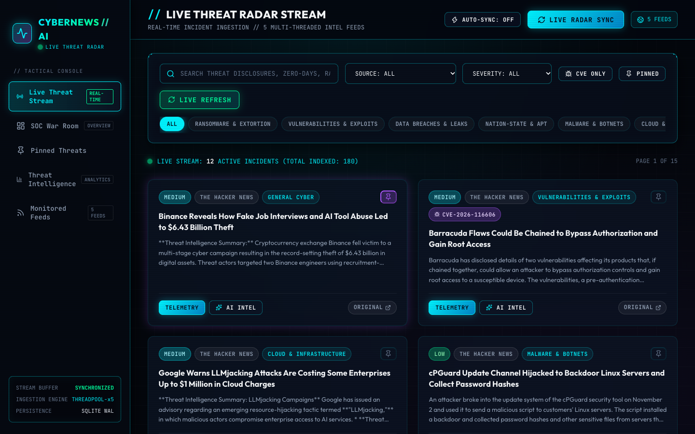
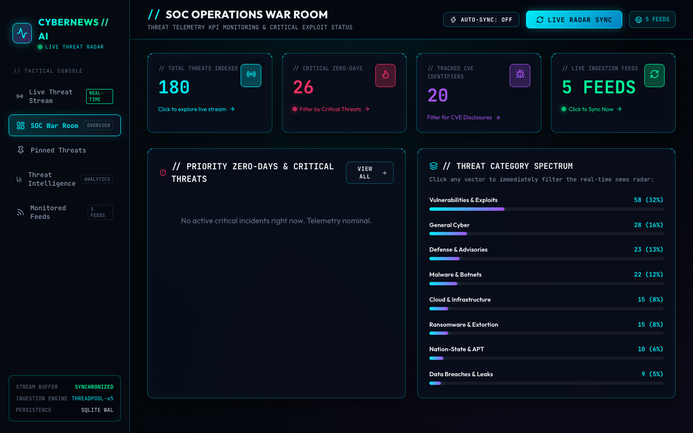
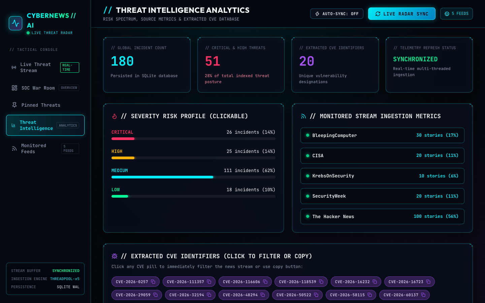
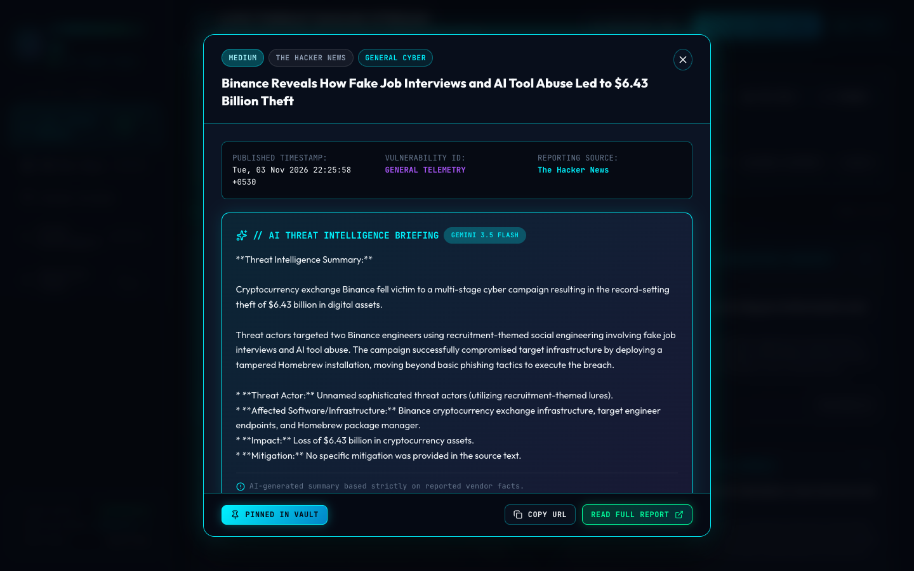

# CyberNewsAI — Cybersecurity Threat Intelligence Platform & Live News Radar

[](https://github.com/utkarshchauhaniitk-star/CyberNewsAI-Pro/actions)
[](LICENSE)
[](https://fastapi.tiangolo.com)
[](https://react.dev/)
[](https://www.sqlite.org/)
[](https://aistudio.google.com/)

---

## 1. Project Overview
**CyberNewsAI-Pro** is a specialized cybersecurity threat intelligence platform and live news radar engineered to aggregate, categorize, and analyze emerging security advisories, vulnerability disclosures, and CVEs across authoritative global research feeds.

- **Developer**: Utkarsh Singh Chauhan (Cybersecurity Student)
- **Repository**: [github.com/utkarshchauhaniitk-star/CyberNewsAI-Pro](https://github.com/utkarshchauhaniitk-star/CyberNewsAI-Pro)
- **Interface Design**: Dark tactical cybersecurity SOC HUD with real-time category filtering and interactive threat inspection.

---

## 2. Problem Statement
Cybersecurity analysts, security researchers, and SOC teams must stay informed of rapidly evolving zero-day exploits, ransomware campaigns, and vendor advisories across dozens of fragmented sources. Manually browsing individual security websites causes alert fatigue, missed vulnerabilities, and delayed mitigation. CyberNewsAI addresses this by centralizing threat telemetry into a single, near-real-time dashboard with automated CVE parsing, severity tiering, and concise executive summaries.

---

## 3. Actual Features
- **Concurrent Multi-Feed Ingestion**: Fetches articles from 5 authoritative research feeds concurrently using Python thread pools.
- **Automated Threat Categorization**: Classifies incidents into 6 core domains:
  - *Ransomware & Extortion*
  - *Vulnerabilities & Exploits*
  - *Data Breaches & Leaks*
  - *Malware & Botnets*
  - *Nation-State & APT*
  - *Cloud & Infrastructure*
- **Regex CVE Identifier Extraction**: Automatically detects Common Vulnerabilities and Exposures designations (`CVE-YYYY-NNNN+`) within article titles and summaries.
- **Dynamic Risk Tiering**: Assigns severity ratings (`Critical`, `High`, `Medium`, `Low`) based on zero-day indicators, active exploitation keywords, and impact keywords.
- **Interactive SOC HUD**:
  - Click any category chip, severity badge, or source pill to filter the feed instantly.
  - Click any extracted CVE badge to filter for related advisories.
  - Pin-to-Vault bookmarking to save notable incidents for forensic follow-up.
- **AI Executive Briefings & Teleprompter Scripting**: Generates structured analyst threat briefings and video scripts using Google Gemini (with an offline heuristic fallback).
- **Offline Fallback Dataset**: Seeds a baseline set of verified cyber threat stories if initial network queries are blocked.

---

## 4. Technology Stack
### Backend
- **Framework**: FastAPI (Python 3.12)
- **Validation**: Pydantic v2
- **Feed Processing**: `feedparser`, `requests`, `beautifulsoup4`, `trafilatura`
- **Database**: SQLite with Write-Ahead Logging (WAL mode)
- **AI Integration**: Google Gemini API (via `google-generativeai` client wrapper)
- **Server**: Uvicorn ASGI Server

### Frontend
- **Framework**: React 19 with Vite
- **Styling**: Tailwind CSS (dark tactical cybersecurity SOC theme)
- **Icons**: Lucide React
- **API Client**: Native `fetch` with typed service layer

---

## 5. Architecture
```
┌─────────────────────────────────────────────────────────────┐
│                 Authoritative Threat Feeds                  │
│   (BleepingComputer, The Hacker News, SecurityWeek,         │
│            CISA Advisories, KrebsOnSecurity)                │
└──────────────────────────────┬──────────────────────────────┘
                               │ Concurrent ThreadPool Polling
                               ▼
┌─────────────────────────────────────────────────────────────┐
│                   FastAPI Backend Engine                    │
│                                                             │
│  ┌──────────────────────┐        ┌───────────────────────┐  │
│  │ Multi-Source Feed    │───────▶│ Threat Classification │  │
│  │ Ingestion & Cleaner  │        │ Engine & CVE Regex    │  │
│  └──────────────────────┘        └───────────┬───────────┘  │
│                                              │              │
│                                              ▼              │
│  ┌──────────────────────┐        ┌───────────────────────┐  │
│  │ Google Gemini AI     │◀───────│ SQLite WAL Database   │  │
│  │ Synthesis / Fallback │        │ (Deduplicated & Index)│  │
│  └──────────────────────┘        └───────────┬───────────┘  │
└──────────────────────────────────────────────┼──────────────┘
                                               │ REST API
                                               ▼
┌─────────────────────────────────────────────────────────────┐
│                    React 19 + Vite SOC HUD                  │
│  - Live Threat Radar Feed       - Pinned Threats Vault      │
│  - Threat Analytics Overview    - Clickable Filter Matrix   │
└─────────────────────────────────────────────────────────────┘
```

---

## 6. Installation

### Prerequisites
- **Python**: Version 3.10+ (tested on Python 3.12.9)
- **Node.js**: Version 18+ (tested on Node v24.12.0)
- Git

### Clone the Repository
```bash
git clone https://github.com/utkarshchauhaniitk-star/CyberNewsAI-Pro.git
cd CyberNewsAI-Pro
```

---

## 7. Environment Configuration
Copy the template configuration file:
```bash
cp .env.example .env
```
Contents of `.env`:
```ini
# Google Gemini API Key for AI Summarization (Optional — heuristic fallback enabled if omitted)
# Obtain a free key at: https://aistudio.google.com/
GEMINI_API_KEY=your_gemini_api_key_here

PORT=8000
HOST=0.0.0.0
```
> **Note**: An API key is optional for testing. If omitted, the platform uses deterministic keyword heuristics for summaries.

---

## 8. Backend Setup
```bash
# Create and activate Python virtual environment
python3 -m venv .venv
source .venv/bin/activate  # On Windows: .venv\Scripts\activate

# Install dependencies
pip install -r requirements.txt httpx

# Run the backend server
python -m uvicorn backend.main:app --host 0.0.0.0 --port 8000 --reload
```
- Backend API will start at: `http://localhost:8000`
- Interactive Swagger docs: `http://localhost:8000/docs`

---

## 9. Frontend Setup
In a second terminal window:
```bash
cd frontend

# Install Node dependencies
npm install

# Start Vite development server
npm run dev
```
- Frontend will be available at: `http://localhost:5173`

---

## 10. Usage Instructions
1. **View the Radar Feed**: Open `http://localhost:5173`. Browse ingested threat stories categorized by severity and domain.
2. **Filter & Search**:
   - Click any **Category** chip (e.g., *Ransomware & Extortion*) to isolate relevant advisories.
   - Click any **Severity** badge (e.g., *Critical*) to view highest-risk alerts.
   - Click any **CVE** identifier to filter all articles mentioning that specific vulnerability.
3. **Pin Notable Threats**: Click **Pin to Vault** on any article card to save it for further triage.
4. **Trigger Feed Refresh**: Click the **Live Radar Sync** button to fetch the latest threat feeds concurrently.
5. **Generate Threat Summaries**: Click on any story to open the detail view and generate an AI-assisted executive briefing.

---

## 11. Screenshots

### Live Threat Radar Feed
> Real-time ingestion stream displaying vulnerability disclosures, threat categories, severity tags, and extracted CVE badges.


---

### SOC Operations Dashboard
> Telemetry metrics, urgent zero-day advisories, and category breakdowns.


---

### Threat Intelligence Analytics & CVE Registry
> Visual charts detailing threat category distributions and extracted CVE identifiers.


---

### Article Detail & AI Executive Threat Briefing Modal
> Structured advisory briefing displaying threat actor, affected infrastructure, and mitigation findings.


---

## 12. AI Functionality Explanation
- **Model Used**: Google Gemini 3.5 Flash via the Google GenAI SDK.
- **Function**: Ingests the article title, publication metadata, and raw content to produce a concise (under 150 words) executive briefing highlighting threat actors, affected software, and remediation guidance.
- **Script Generation**: Synthesizes structured teleprompter scripts for security briefing broadcasts (`POST /api/scripts/generate`).
- **Deterministic Heuristic Fallback**: If `GEMINI_API_KEY` is not provided or if the API quota is reached, CyberNewsAI automatically switches to deterministic keyword extraction and heuristic summarization so the application continues to function without interruption.
- **Accuracy Disclaimer**: AI-generated summaries are assistive and must be verified by a security analyst against official vendor advisories and CVE records.

---

## 13. News Source Attribution
All aggregated threat news items are fetched from publicly available RSS feeds provided by authoritative cybersecurity research entities:
1. **BleepingComputer** ([bleepingcomputer.com](https://www.bleepingcomputer.com))
2. **The Hacker News** ([thehackernews.com](https://thehackernews.com))
3. **SecurityWeek** ([securityweek.com](https://www.securityweek.com))
4. **Cybersecurity & Infrastructure Security Agency (CISA)** ([cisa.gov](https://www.cisa.gov))
5. **KrebsOnSecurity** ([krebsonsecurity.com](https://krebsonsecurity.com))

Each card prominently displays the source name and provides a direct, outbound hyperlink with `rel="noopener noreferrer"` to the original research article.

---

## 14. Testing

### Run Backend API Test Suite:
```bash
python test_backend_api.py
```
**API Integration Results**: **8/8 verification tests passed** covering:
- `/api/health`: Service health check.
- `/api/categories` & `/api/sources`: Ingestion sources and category metadata.
- `/api/articles`: Pagination, listing, and ordering.
- Search and filtering: Keyword query and category isolation.
- `/api/articles/{id}`: Detail modal retrieval.
- `/api/threat-stats`: Severity distribution and CVE registry.
- `/api/articles/{id}/summarize`: AI / heuristic briefing generation.
- `/api/scripts/generate` and export: Briefing script generation and download.

### Run Pytest Unit Processing Suite:
```bash
PYTHONPATH=. pytest tests/ -v
```
**Unit Processing Results**: **8/8 unit tests passed** covering:
- `test_clean_html_utility`: HTML tag stripping and sanitization.
- `test_deduplicator_removes_exact_and_link_duplicates`: Multi-source title & canonical URL deduplication.
- `test_deduplicator_handles_malformed_entries_safely`: Missing title/link resilience.
- `test_cve_extraction_and_normalization`: Regex detection and uppercase deduplication.
- `test_threat_classification_and_severity`: Categorization rules and Critical/High marker evaluation.
- `test_iso_date_parsing_resilience`: RFC 2822, ISO-8601, and timezone-aware UTC handling.
- `test_deterministic_article_id_generation`: SHA-256 fingerprint collision prevention.
- `test_ai_summary_heuristic_fallback_integrity`: Offline summary generation without API key.

Total Backend Test Coverage: **16/16 Tests Passed (100% Success)**.

### Test Frontend Production Build:
```bash
cd frontend
npm run build
```
**Build Result**: Built cleanly in 0.74s with zero errors.

---

## 15. Security Considerations
- **Content Sanitization**: Ingested RSS descriptions and HTML payloads are parsed using BeautifulSoup to strip script tags, iframes, and malicious markup before rendering.
- **Secure Links**: Outbound links to external articles open in isolated contexts (`target="_blank" rel="noopener noreferrer"`).
- **Environment Isolation**: API keys are loaded via server-side environment variables and never transmitted to or embedded in the client frontend bundle.
- **Parameterized SQL**: All database operations use SQLite parameterized queries to prevent SQL injection.
- **No Active Scanning**: CyberNewsAI only ingests public feeds passively; it does not perform active probing, scanning, or penetration testing.

---

## 16. Limitations
- **Feed Availability**: Near-real-time updates depend on the availability and responsiveness of external vendor RSS endpoints.
- **Heuristic Severity**: Threat severity ratings are computed heuristically based on keyword indicators; they represent triage suggestions rather than certified CVSS scores.
- **AI Quota**: Full AI synthesis requires a Google Gemini API key; offline deployments rely on heuristic extraction.

---

## 17. License
This project is licensed under the **MIT License**. See the [LICENSE](LICENSE) file for complete details.
